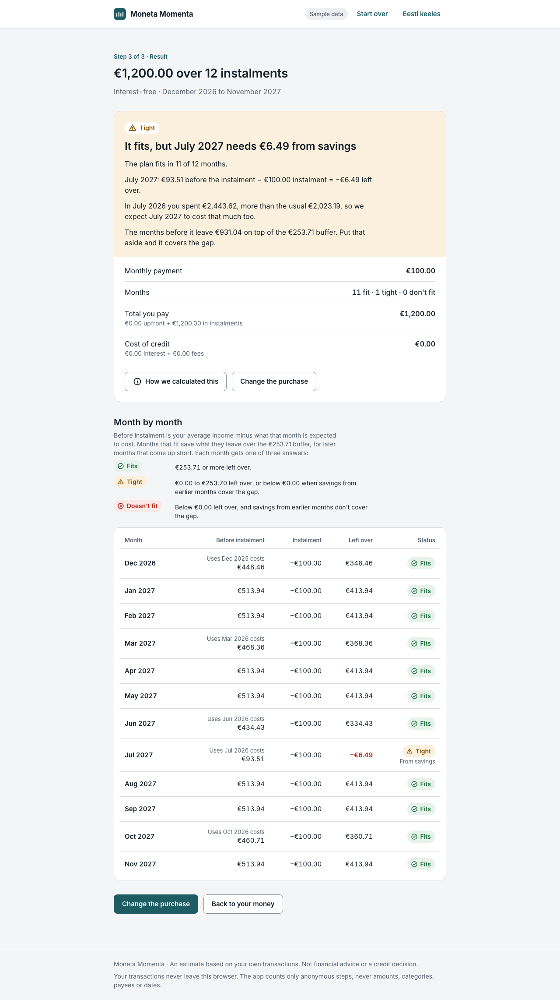

# Moneta Momenta

People decide to pay for something in instalments without seeing how the monthly payments stack on top of what they really spend. This app takes your budget history and shows, month by month, whether an instalment plan fits before you commit.

It's for small loans and instalment purchases of up to 5 years, not mortgages. It's an estimate from your own transactions, not financial advice or a credit decision.

**Live:** https://moneta-momenta.vercel.app ([Eesti keeles](https://moneta-momenta.vercel.app/et))

Each link below opens the result for a sample household straight away:

- [€100 × 3: fits](https://moneta-momenta.vercel.app/en?sample=comfortable&price=100&n=3)
- [€1,200 × 12 over the last 12 months: tight](https://moneta-momenta.vercel.app/en?sample=comfortable&period=12&price=1200&n=12)
- [€1,200 × 12 over the last 6 months: tight, because July comes up €6.49 short and earlier months' savings cover it](https://moneta-momenta.vercel.app/en?sample=comfortable&price=1200&n=12)
- [€3,000 × 6: doesn't fit, because December and another month come up short](https://moneta-momenta.vercel.app/en?sample=comfortable&price=3000&n=6)



## How it works

1. **Your data.** Choose a transactions file, or try one of the two samples (a made-up Estonian household's year). The file is read in the browser and never leaves it; how it's handled is spelled out right under the file button.
2. **Your money.** The app shows the full months it used, your average income, your average spending by category group and what's usually left over. You can average over the last 3, 6 or 12 months.
3. **The purchase.** Price, an optional upfront payment, 3 / 6 / 12 or any number from 2 to 60 instalments, an interest rate (it starts at 9.9% a year, midway between typical small-loan offers; 0 for interest-free) and an optional monthly fee. Sample links without a rate mean 0%.
4. **The result.** A verdict, a month-by-month table, and "How we calculated this", which shows every number behind the verdict.

## Why a budgeting-app export, not a bank statement

A bank statement doesn't say what a payment was for. Payee text is cut short, nothing is categorised, and moving money between your own accounts looks like spending. A budgeting app's export already has categories and marks transfers, so the totals mean what they say.

The app accepts a **format**, not a product. Any tab- or comma-separated file with these columns works; other columns are ignored. A YNAB register export (Accounts view, any date range) already matches.

| Column | What it holds |
|---|---|
| `Date` | `DD/MM/YYYY` |
| `Payee` | May be empty. `Transfer : …` marks a move between your own accounts. |
| `Category Group` | `Inflow` for income, `Credit Card Payments` for paying off a card |
| `Category` | The spending category |
| `Outflow`, `Inflow` | Amounts with 2 decimals, decimal comma or dot, optional `€` and thousands separators |

A [template file](https://moneta-momenta.vercel.app/transactions-template.csv) shows the minimum. When a file can't be used, the error says what's wrong (the line, or which columns are missing) and what to do next.

## Product decisions

- **What counts.** Income is the `Inflow` group. Spending is every other category, net of refunds. Left out of both, and listed in the explanation: transfers between your own accounts, credit card payoffs (the purchases were already counted when you made them), opening balances, and rows with no category.
- **Which months.** Only full months count. The current month is never used, because it isn't over. At least 3 full months are needed, so one odd month can't decide the average. If a file starts or ends partway through a month, that month is kept and flagged: missing spending makes plans look easier to afford than they are, and from dates alone a cut-off export looks the same as a quiet week.
- **Expensive months come back.** Each plan month expects the higher of your average spending and what you actually spent in that calendar month last year. Last July's holiday makes next July tight; a cheap month never makes a plan look better. Income stays at the average.
- **Fits / tight / doesn't fit.** A month *fits* when at least 10% of your average income is left after the instalment, is *tight* between €0 and that, and *doesn't fit* below €0. Months aren't judged alone: a month that fits saves what it leaves above the cushion, and a later short month is *tight* if those savings cover it. The verdict is the worst month, except that one short month among months that all fit makes the plan tight, not refused. It's always shown with its numbers. Status is never shown by colour alone: each one has its own icon and label.
- **One-off amounts are shown, not removed.** A category or income source with one month far above its usual (more than 3× its median and at least €100 above it) is listed as a one-off. It stays in the averages, because the seasonal rule already expects it again in the same month; taking it out would only make plans look easier to afford. One-off *income* gets the same note: a tax refund raises the average, but it may not come again.
- **Interest.** An annual rate becomes a total through the standard annuity formula, plus any monthly fee. No APR is shown: it's a regulated disclosure, and this isn't a lender. The first instalment is due the month after the purchase.
- **Money is integer cents.** No floating point in the maths. Instalments are whole cents and add up exactly to the total; the remainder goes on the last one.

## Privacy

- The file is parsed in the browser. Transactions are never sent anywhere, stored or put in the URL. The Content Security Policy (`connect-src 'self'`) stops the page's scripts from connecting to any other site, and `script-src` has no `'unsafe-inline'`, so injected markup can't run code.
- Anonymous product events (below) carry no amounts, categories, payees, dates or IDs, only fixed values and coarse buckets.

## How success would be measured

If this were a real feature, the anonymous events it already sends would answer:

- **Does it get used?** Funnel from `flow_started` → `plan_checked` → `explanation_opened`, split by sample vs upload.
- **Can people get their data in?** `import_failed` by reason (missing columns, bad date, too little data …) shows which formats confuse people.
- **Is it useful?** The verdict mix in `plan_checked`. If almost everything fits, the check isn't telling anyone anything new.
- **Do people trust it?** How often the explanation is opened after a tight or doesn't-fit verdict.

In this demo the events go to the browser console (`[telemetry]`). In production they would go to a collector endpoint instead.

## How it was built

Built with Claude Code from a product brief. The tech plan ([TECH-PLAN.md](TECH-PLAN.md)) came first; Margus approved it and made the product decisions, which are marked ✅ there. The app was then built in small pull requests ([history](https://github.com/mungoose/moneta-momenta/pulls?q=is%3Apr+is%3Amerged)), each explaining why the change was made. The aim was a working result quickly, so the pull requests were read through rather than reviewed line by line. The automated checks below carry the weight; before real production, the core logic and every later change would get a closer review.

- **Test-first core.** `src/lib` is pure TypeScript with no React. Its tests and hand-written edge-case files (split transactions, refunds, transfers, a month with no income, a cut-off export, another bank's CSV …) were written before the code, and the sample's monthly totals were checked against an independent calculation.
- **Mutation testing.** Stryker changes the core's code and checks that a test fails each time. The score is **100%**: 1,122 mutants, none surviving. Mutation is switched off in 13 places, each with a comment giving the reason: the mutant behaves the same as the original, it only changes an error's diagnostic text, or it sits in a defensive branch no input can reach.
- **Unit tests.** 550 Vitest tests over the core: parsing, classification, months and averages, one-off amounts, instalments, the verdict, form input, sample links and telemetry payloads.
- **End-to-end tests.** Playwright runs against a production build at desktop (1280 px) and phone (390 px) width. It covers the sample flow from landing to verdict, the sample links, every upload error and warning, the explanation drawer (its numbers, keyboard and focus), the language switch, routing and the 404 page. It also checks that each flow sends exactly the expected telemetry events, that every screen passes axe accessibility checks in the light and dark themes, and that the CSP blocks an injected inline script.
- **CI.** Typecheck, lint, formatting, unit tests, end-to-end tests and the mutation run on every pull request; a mutation score below 80% fails the build.

## Not built, on purpose

- **Bank statement import.** See above: without categories, the totals would be guesses.
- **Latvian and Lithuanian.** Translations nobody here can check shouldn't ship.
- **Accounts or a database.** Nothing about your money is stored, so there's nothing to leak.
- **Credit decisions or advice.** It shows what your own numbers say, nothing more.

## What would come next

- Suggestions for which categories to cut, and by how much, to make a plan fit. Code would compute every number; a language model would only pick from a menu of cuts and explain why.
- Comparing two plans side by side (3 vs 12 instalments).
- Counting a cash buffer, so an upfront payment can be checked against savings.
- Letting people pick the date format, or detecting it, instead of fixing it to `DD/MM/YYYY`.

## Run locally

Node 26 (`nvm use`), then:

```bash
npm ci
npm run dev
```

| Command | What it runs |
|---|---|
| `npm run check` | typecheck, lint, format check, unit tests |
| `npm run test:mutation` | Stryker on `src/lib` |
| `npm run test:e2e` | Playwright against a production build |
| `npm run build` | production build with CSP script hashes |

---

**The name.** *Moneta* was a title of the Roman goddess Juno. Her temple housed Rome's mint, which is where "money" and "mint" come from, and the name is traditionally linked to *monere*, "to warn". *Momenta* is the plural of *momentum*, originally the small weight that tips a balance. Together: the app warns you which months tip a plan from "fits" to "doesn't fit".
